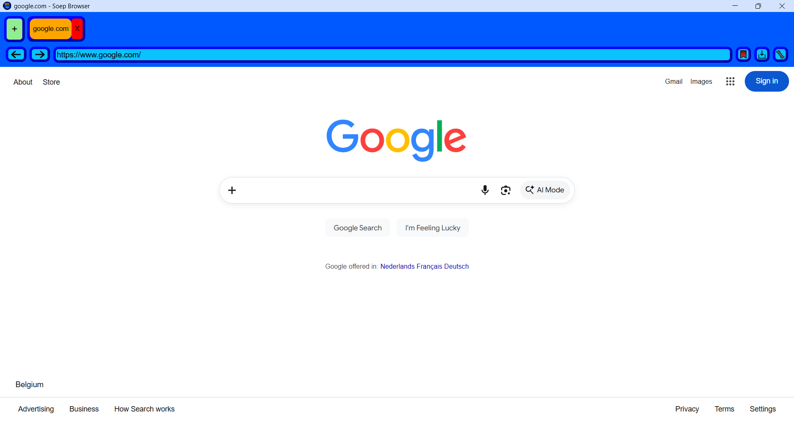

# Soep Browser

An easily modifiable open-source browser built with NW.js.

## Features

- No AI integration
- No data collection
- Easily modifiable
- Turn off features you don't use

## Installation

### Windows
- Go to releases
- Download and open **Soep Browser installer.exe**.
- Follow the installation wizard.
- Now you can open Soep Browser from the start menu or the desktop.

### Linux
- Go to releases
- Download **Soep_Browser-x86_64.AppImage**
- Now you can open the file to start Soep Browser.
  
## Development Setup

A version of NW.js is required to test the browser.

- Download NW.js at:  [https://nwjs.io](https://nwjs.io)

- Extract the NW.js archive.

- Download the folder **app**.

- Put the contents of the downloaded folder into the root of the NW.js installation.

- To test on Windows run **nw.exe**, on Linux **nw**.

## TODO

- Linux support for features: **start with system** and **kiosk mode**.
